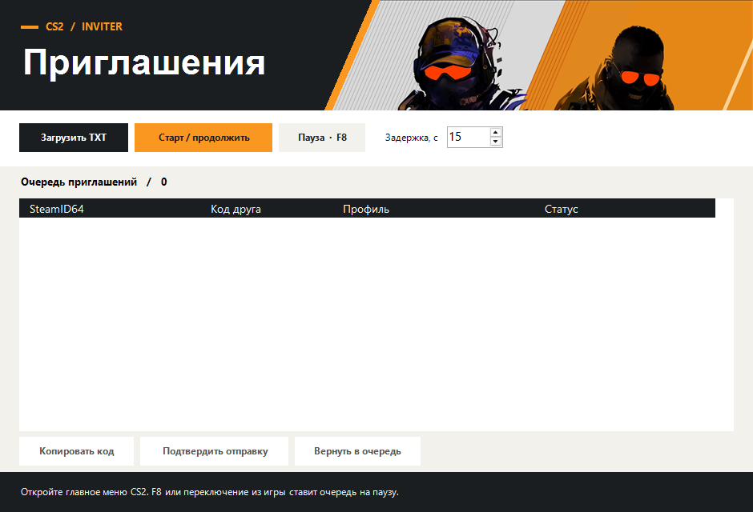

# CS2 Inviter

Приложение для Windows, которое приглашает игроков в лобби Counter-Strike 2 по списку SteamID64. Оно управляет открытым меню игры и распознаёт результат по тексту уведомления.



## Запуск

1. Скачайте **CS2Inviter.exe** из [релиза v0.1.0-beta.3](../../releases/tag/v0.1.0-beta.3).
2. Откройте главное меню CS2. Для этого выпуска нужны Windows x64 с русским OCR, русский интерфейс игры и полностью видимое окно 16:9 шириной от 960 пикселей. Интерфейс проверялся при 1920 × 1080.
3. Нажмите **Загрузить TXT**. Укажите индивидуальные SteamID64 по одному на строку или разделите их пробелами, запятыми либо точками с запятой. Программа пропускает повторы и показывает число некорректных значений.
4. Установите задержку в секундах и нажмите **Старт / продолжить**. Оставьте CS2 активной. При вводе кода приложение использует буфер обмена Windows.

## Очередь и пауза

Отправка подтверждается по новому уведомлению «приглашает» с ником игрока. При распознанном лимите программа оставляет текущий ID в очереди и увеличивает интервал повторов. Если результат неясен, проверьте чат лобби, выберите строку и нажмите **Подтвердить отправку** или **Вернуть в очередь**.

F8, потеря фокуса игры или распознанное уведомление о входе игрока ставят очередь на паузу. Для продолжения нужен ручной запуск. Состояние хранится в `%LOCALAPPDATA%\CS2Inviter\queue.json`. Перед кликом по кнопке приглашения запись получает статус «Проверить отправку», чтобы после сбоя оператор мог исключить повторную отправку.

## Сборка из исходников

В PowerShell из корня репозитория выполните:

```powershell
.\build.ps1
```

Скрипт использует компилятор .NET Framework 4.x и WinRT-метаданные Windows. Готовый файл появится в `dist\CS2Inviter.exe`. Иллюстрация встроена в EXE.

## Статус проверки

Это предварительный выпуск для приёмочного теста. Конвертер проверен на 1 003 значениях. В живом интерфейсе проверены поиск по коду, чтение ника и распознавание карточки. Уведомление об успешном приглашении наблюдалось при отдельной тестовой отправке. Автоматический цикл из выпускаемого EXE, пауза при реальном входе игрока и повтор после реального лимита требуют проверки в лобби.


